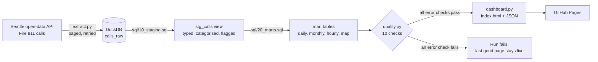

# Seattle Fire 911 Calls: an Automated Data Pipeline

A scheduled pipeline that pulls every Seattle Fire Department 911 call from the City of Seattle's open-data API each morning. It loads the calls into a DuckDB warehouse, transforms them with SQL and runs data-quality checks. Then it publishes a live dashboard, but only if the checks pass.

### [▶ Live dashboard](https://fochakos.github.io/seattle-911-pipeline/) · updated daily by GitHub Actions

[](https://github.com/fochakos/seattle-911-pipeline/actions/workflows/pipeline.yml)
[](https://github.com/fochakos/seattle-911-pipeline/actions/workflows/tests.yml)

## How it works



| Step | What it does | Design choice |
|---|---|---|
| **Schedule** | [`pipeline.yml`](.github/workflows/pipeline.yml) runs every morning (and on demand) | GitHub Actions: free, logged, and visible to anyone |
| **Extract** | [`extract.py`](pipeline/extract.py) pages through the Socrata API, 50,000 rows per request | Ordered by time *and* incident number, so paging never skips or repeats rows. Retries with backoff on rate limits and server errors, but not on 4xx errors, which mean a bug. |
| **Load** | [`load.py`](pipeline/load.py) upserts into DuckDB keyed on incident number | **Incremental:** each run starts 3 days before the latest loaded call, to pick up late corrections. **Idempotent:** re-running a batch changes nothing. New vs. corrected rows are counted separately. |
| **Transform** | [`10_staging.sql`](sql/10_staging.sql) → [`20_marts.sql`](sql/20_marts.sql) | A staging view does the cleaning (types, categories, test flags, bounding box); small mart tables feed the dashboard. Only complete days are reported. |
| **Check** | [`quality.py`](pipeline/quality.py) | 10 checks. **Error** checks (freshness, duplicates, missing fields, missing days, future dates) stop publication; **warn** checks are shown on the dashboard. |
| **Publish** | [`dashboard.py`](pipeline/dashboard.py) writes a static page with Vega-Lite charts, plus [`latest.json`](https://fochakos.github.io/seattle-911-pipeline/data/latest.json), `daily_calls.csv` and `runs.json` | No server to run or pay for |
| **Persist** | The warehouse is kept in the Actions cache between runs | If the cache is evicted, the next run backfills from 2021 automatically, so the API is the source of truth |

Every run, including failures, is logged to a `pipeline_runs` table and shown on the dashboard: rows fetched, new, changed, duration and status.

## Data-quality checks

| Check | Severity | Rule |
|---|---|---|
| Warehouse has data | error | > 0 rows |
| Data is fresh | error | latest call ≤ 24 hours old |
| No calls in the future | error | none more than 1 hour ahead of Seattle time |
| Incident numbers unique | error | 0 duplicates |
| Required fields present | error | ID, time and type never missing |
| No missing days | error | every day since 2021 has calls |
| Coordinates present | warn | ≥ 99% (last 30 days) |
| Coordinates inside Seattle | warn | ≥ 99% inside the city's bounding box |
| Call types categorised | warn | ≤ 10% left as "Other" |
| Yesterday's volume is normal | warn | within 3 SD of the previous 28 days |

## What the first load found

The first run loaded **696,343 calls** (1 Jan 2021 to 2 Nov 2026) in about 80 seconds. Each daily run after that takes a few seconds. Findings from the data:

- **479 test records** ("TEST - MIS TEST") are mixed into the live feed. They're flagged in staging and excluded from every chart.
- **1,693 calls (0.24%) have no coordinates**, and 281 more fall outside Seattle's bounding box. They stay in the counts but are left off the map.
- **173 distinct call types.** Ordered keyword rules put them into 7 categories. Order matters: "Auto Fire Alarm" must be an Alarm, not a Fire, and "MVI Medic" a Traffic call. Dispatch codes whose meaning isn't published, such as "1RED 1 Unit", are left as "Other" rather than guessed (5.6% of recent calls).
- **Medical calls are 75%** of all calls since 2021. The busiest hours are weekday afternoons (Tuesday 4 pm averages 19 calls an hour); the quietest is around 4 am (about 6 an hour).
- **Volume:** calls rose every year from 2021 (106,948) to 2024 (129,588), fell in 2025 (119,211), and 2026 is running about 7% behind 2025 at the same date.

## Engineering notes

Four issues came up while building this, each now fixed and covered by a test where possible:

1. **DuckDB 2.0 is stricter about open results.** `fetchone()` left a result open and blocked the next statement. All queries now read their full result.
2. **A semicolon inside a SQL comment** ("applied in order; first match wins") split a statement in two. The SQL runner now removes comments before splitting.
3. **Mixed timestamp formats** (with and without fractional seconds) crashed the load in a test, although the live feed is consistent today. Timestamps are now parsed as ISO 8601.
4. **The volume check divided by zero** when every day in the window had the same count, and silently skipped itself. The spread now has a floor of √mean (daily counts behave like Poisson counts), and the check always reports.

## Tests

18 offline tests in [`tests/test_pipeline.py`](tests/test_pipeline.py) run on every push ([`tests.yml`](.github/workflows/tests.yml)). A fake HTTP session replaces the API, and synthetic calls go into an in-memory DuckDB. They cover:

- **Extract:** paging and retries (server errors are retried, client errors are not).
- **Load:** idempotent upserts, corrected rows and the watermark.
- **Transform:** the category rules and test-record exclusion.
- **Quality checks:** each check fires on the problem it's meant to catch, such as stale data, a future timestamp, a missing day or a volume spike.
- **Dashboard:** a smoke test that the page builds.

## Run it yourself

Requires Python 3.11+. No API key is needed.

```bash
pip install -r requirements.txt
python -m pipeline.run                    # first run backfills from 2021 (about 2 minutes), later runs are incremental
python -m unittest discover tests         # 18 tests, no network needed
python -m http.server 8000 --directory site   # then open http://localhost:8000
```

Settings such as the start date, lookback window and database path live in [`pipeline/config.py`](pipeline/config.py) and can be overridden with environment variables. An optional `SOCRATA_APP_TOKEN` raises the API rate limit.

## Limitations

- **Deleted source records stay in the warehouse.** The pipeline upserts but doesn't detect rows removed upstream. A periodic full reload would handle this.
- **Categories are keyword rules,** not an official taxonomy.
- **GitHub pauses scheduled workflows** after 60 days without repository activity; re-enable from the Actions tab.
- Timestamps are Seattle local time as published. In the hour when clocks go back in November, times are ambiguous.

## Project structure

```
├── .github/workflows/
│   ├── pipeline.yml      # daily schedule: run pipeline, publish to Pages
│   └── tests.yml         # tests on every push
├── pipeline/
│   ├── config.py  extract.py  load.py  transform.py  quality.py  dashboard.py  run.py
│   └── template.html     # dashboard page
├── sql/
│   ├── 10_staging.sql    # cleaning, categories, flags
│   └── 20_marts.sql      # daily, monthly, category, hourly, map, KPI tables
└── tests/test_pipeline.py
```

## Data

[Seattle Real Time Fire 911 Calls](https://data.seattle.gov/Public-Safety/Seattle-Real-Time-Fire-911-Calls/kzjm-xkqj), City of Seattle open data (public domain). Updated by the city every few minutes.

## Tools

Python · SQL (DuckDB) · GitHub Actions · GitHub Pages · Altair / Vega-Lite · requests · unittest
